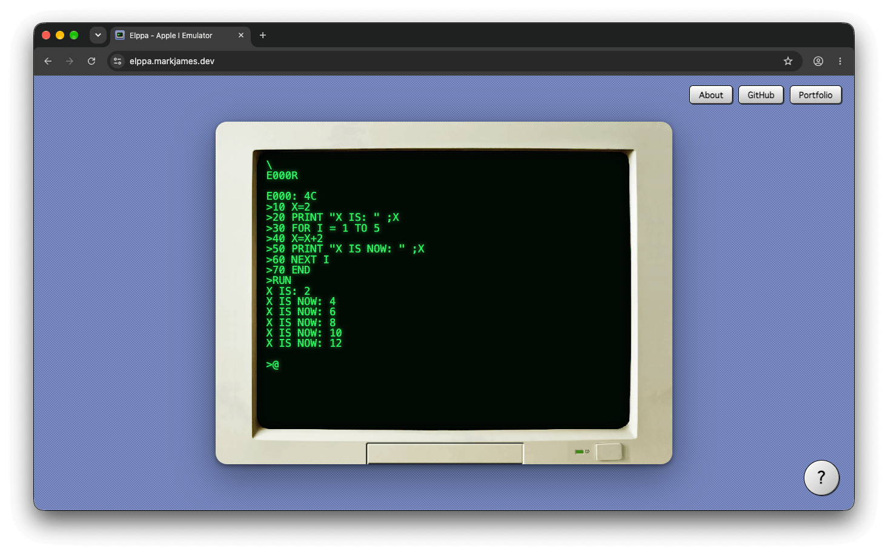

# Elppa

An [Apple I](https://en.wikipedia.org/wiki/Apple_I) emulator that [runs in your browser](https://elppa.markjames.dev). Written in C# and Blazor WebAssembly, Elppa is powered by [Velutia](https://github.com/markjamesm/Velutia), my instruction-level accurate
MOS 6502 CPU core.

   Elppa running Integer BASIC in the browser via Blazor WebAssembly.

## Usage
- The system boots into [wozmon](https://www.sbprojects.net/projects/apple1/wozmon.php) where you can examine and change memory contents and start machine language programs.
- [Integer BASIC](https://en.wikipedia.org/wiki/Integer_BASIC) is available by typing `E000R` at the wozmon prompt.

## Interfaces

Elppa supports both web and command-line interfaces.

### Web Interface

- Visit the [Elppa website](https://elppa.markjames.dev) for an interactive demo.
- For local development, build and run the `Elppa.Blazor` project.

### Console Interface

- Build and run the `Elppa.Cli` project.

