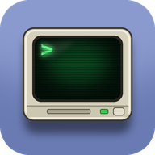

  

<h1 align="center">Elppa</h1>

An [Apple I](https://en.wikipedia.org/wiki/Apple_I) emulator that [runs in your browser](https://elppa.markjames.dev). Written in C# and Blazor WebAssembly, Elppa is powered by [Velutia](https://github.com/markjamesm/Velutia), my instruction-level accurate
MOS 6502 CPU core.

   <em>Elppa running Integer BASIC in the browser via Blazor WebAssembly.</em>

## Usage
- The system boots into [wozmon](https://www.sbprojects.net/projects/apple1/wozmon.php) where you can examine and change memory contents and start machine language programs.
- [Integer BASIC](https://en.wikipedia.org/wiki/Integer_BASIC) is available by typing `E000R` at the wozmon prompt.

### Web Version

- Visit the [Elppa website](https://elppa.markjames.dev).

### Console Version

- Build the `Elppa.Cli` project from source and run it.

